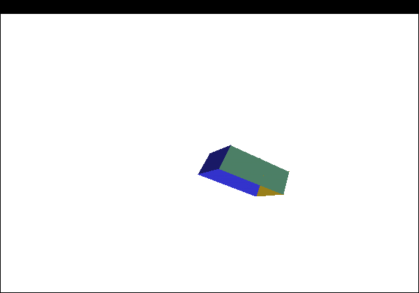

# Simple Renderer (Computación Gráfica)

Final project for a Computer Graphics course (2018): a small software rasterizer written
from scratch in C++. It draws into an FLTK window pixel by pixel — no OpenGL — and
implements the classic pipeline stages by hand:

| Algorithm | Where |
|---|---|
| Bresenham line drawing | `struct Bresenham`, `renderer/geometry.h` |
| Scan-line polygon fill | `struct ScanLine`, `renderer/geometry.h` |
| Cohen–Sutherland line clipping | `struct CohenSutherland`, `renderer/geometry.h` |
| Sutherland–Hodgman polygon clipping | `struct SutherlandHodgeman`, `renderer/geometry.h` |
| Perspective projection, transformations | `struct Transformations`, `renderer/geometry.h` |
| Depth buffer, color interpolation, lighting | `renderer/geometry.h`, `renderer/triangle.cpp`, `renderer/polygon.cpp`, `renderer/renderer.cpp` |

The scene (camera, lights, objects, transformations) is read from a text file;
`raylite.cpp` loads `data/test-cubo.scn`.



*Running on Linux. The earlier macOS captures of each stage are in `docs/`:
[Bresenham](docs/Bresenham.png), [ScanLine](docs/ScanLine.png),
[Clipping](docs/Clipping.png), [Polygon clipping](docs/ClippingDePoligono.png),
[Perspective](docs/Perspective.png), [Depth](docs/Depth.png),
[Interpolation](docs/Interpolation.png), [Illumination](docs/Ilumination.png).*

## Build

Needs a C++ compiler and [FLTK 1.3](https://www.fltk.org) (`sudo apt install libfltk1.3-dev`).

```sh
make                                   # uses fltk-config from PATH
make FLTK_CONFIG=/path/to/fltk-config  # or an FLTK installed elsewhere
```

## Run

Run from the repository root (the scene path is relative):

```sh
./raylite
```

Drag with the left mouse button to rotate the camera, with the right button to move it
forward and back.

## Layout

| Path | Contents |
|---|---|
| `raylite.cpp` | entry point |
| `renderer/` | engine, scene parser, camera, viewport (FLTK widget), rasterizer |
| `math/numerical/`, `math/euclidean/` | vector/matrix templates, points and transformations |
| `structures/` | a small stack template |
| `data/*.scn` | scene files |
